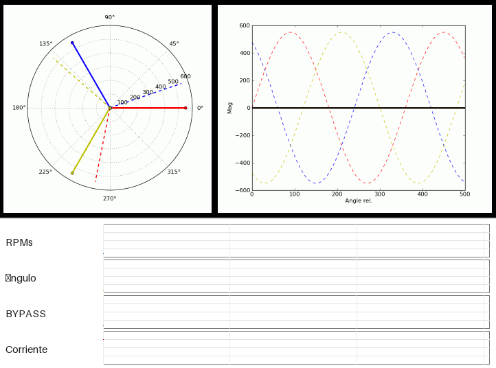

---
tags:
- asynchronous
- cutin
- cutout
- hub
- pitch variable
- grid
- thyristors
- bypass contactor
- exit production
- start of production
- bypass
- phasors
- phasor representation
- synchronous speed
- soft connection
- soft starter
- phasor
- synchronous
---

# Soft starter (soft connection) to the grid

## Purpose of this algorithm

This algorithm is used during the generator stator grid connection process.

## Description of the grid connection problem.

When the grid connection process (**cutin**) begins, the generator stator is disconnected from the grid. Therefore, there is no magnetic flux in the generator air gap (see [Introduction to induction machines](IntoductiontotheInductionMachine.md)) and as a result the generator does not generate any electrical power even if its shaft is rotating.

The only way to create a magnetic field in the air gap, so that *the mechanical power that moves the shaft is transformed into electrical power*, is by connecting the stator to the grid.

As shown in [Introduction to induction machines](IntoductiontotheInductionMachine.md), for this machine to work as a generator it is necessary that its *shaft revolutions be above its synchronous speed*.

Therefore, the algorithm used by the Controller during the *cutin* sequence is:

- It keeps the stator disconnected from the grid, while applying the mechanical torque, coming from the wind on the blades, adjusting it at each moment by modifying the blade angle value.

- It continuously monitors the generator shaft revolutions value.

- When these revolutions are close to but below synchronism (1480 to 1490 rpms in the case of synchronism at 1500 rpms), then it connects the stator to the grid, but not directly, but *through the thyristors*. This connection, which lasts a few seconds (3 to 4), has the objective that at the end:

- ○alternating current (from the grid) begins to pass through the stator, to create a magnetic flux synchronous with the grid, but initially small. This is achieved by changing the *electrical conduction angle of the thyristors*.

- ○this current increases in value progressively, so that there is a motoring phase (taking energy from the grid to drive the generator shaft) until reaching the synchronism one, at which moment, the thyristor conduction angle is the maximum (180 electrical degrees), at which moment we will have:

- shaft speed equal to the synchronism one.

- stator current will be synchronous with the grid (identical phase angles).

## Phasor representation of the signal evolution in a Soft starter

 <button onclick="document.getElementById('SoftStarter').src='lib/SoftStarter.gif';">Refresh</button>

<u>Left panel</u>: *Phasor diagram of a three-phase grid*. Each of the colors with continuous line corresponds to the phasor of one of the phases. The circumferences indicate the voltage of each phase with respect to the neutral. The dotted lines correspond to the average voltage that reaches each generator stator terminal.  
<u>Right panel</u>: *Dotted lines*: voltage in each of the grid phases. Continuous lines: voltage at the generator terminals.

The wind turbine emulated in this simulator has an induction generator with squirrel-cage rotor (short-circuited rotor), and the stator connects directly to the electrical grid.

As discussed in [Operating principle of a wind turbine with squirrel-cage generator directly connected to the grid](Porqugiranlaspalas1.md) this type of generator conditions the wind turbine functioning and operation.

The basic operations in relation to the electric generator are the '*production start*' (*cutin*) and '*production exit*' (*cutout*).

During production start, the power train starts from rest and its rotation speed increases by the wind effect and the pitch angle value, until it reaches the '*synchronous speed*'. That is, until the generator shaft speed is in the vicinity of the generator synchronous speed. In all this transition, the stator is disconnected from the grid. For the asynchronous generator to really produce electrical energy that the grid takes away it is necessary:

- That there be interaction between two magnetic fluxes: one generated by the stator winding (and therefore synchronous with the grid frequency - 50 Hz or 60 Hz depending on countries), and another generated by the current induced in the rotor, which is short-circuited. The rotor current has a frequency that is proportional to the slip (the difference between the real rotation speed of the generator mechanical shaft and the synchronous speed, in relation to the synchronous speed); in generator operation this slip value is usually very low, in the order of 1% or less, depending on the generator quality. With a 1% slip the rotor current frequency will be (1500 * 0.01 = 15 Hz).

- That the mechanical power source connected to the generator shaft (the Power Train) be sufficient to make this shaft rotate at a speed a bit higher than the synchronism one, and also that the stator be connected to the grid.

This problem is common to many electrical generation systems (for example those used in generator sets) and the *Softstarter* is a common procedure to achieve it. The operation way is the following:

- 1.In the initial phase, when the generator shaft speed is far from the synchronism one, the blade pitch angle is controlled so that the power train acceleration makes its speed reach the one corresponding to the generator synchronism, with a controlled acceleration.

- 2.When this speed is close to the synchronism one, but below, voltage is supplied to the stator through blocks of two Thyristors connected in antiparallel (anode of one, with the cathode of the other). The Thyristors are electronic devices with three connections: the anode, the cathode and the gate. They allow conducting current uni-directionally between anode and cathode, but allow controlling the AC cycle angle, conducting only during a certain part of the cycle. Two are connected in antiparallel to allow directional conduction. This is shown in the animated figure. The conduction angle is determined by the moment at which the gate is excited with respect to the cathode.  
The objective is to supply voltage to the stator so that it can generate the magnetic flux, but in a controlled way, starting with a small value, until conducting during the whole cycle. In this way, the "average" value of this voltage increases, from 0 and, eventually, it will end connected to the grid continuously.

- 3.Initially, the Thyristors do not conduct. See the animated figure. In this figure, the right panel presents the voltages in the three phases of a three-phase grid. In the left panel, the three continuous lines (red, green and blue) correspond to vectors of each of the three phases, "phasors": one vector per phase, where the phase shift between them (120º) can be seen, and where the "time" variable is a vector that "comes out of the screen".  
In the right panel the voltages in each of the grid phases are shown, with dotted lines.  
In the *phasor representation* the moment at which the Thyristors begin to conduct can be seen well, which occurs when the generator voltage frequency is lower than the synchronism one (which coincides with the grid one). The effect of the Thyristor conduction is that the generator frequency *rate of change* is reduced, until it becomes equal to the grid one.

- 4.When the generator shaft speed approaches the synchronous speed, the controller starts the progressive opening of the Thyristor conduction angle, so that the stator begins to have current that generates the air gap magnetic field.  
This fact is represented by the three phasors with dotted lines: since the shaft is not yet at the synchronous speed, these phasors "rotate" with a speed corresponding to the speed difference. Their length corresponds to the average voltage in the cycle in which it occurs due to the Thyristor conduction angle.  
Eventually, both speeds become equal, at which instant, the generator is connected to the grid through the Thyristors, and the dotted lines are on the fixed ones, and at the synchronous speed.

- 5.When enough time has elapsed (in the order of some seconds), the shaft speed, pushed by the Power Train, exceeds the synchronism one, so that the stator induces current in the rotor, which generates a magnetic flux that tends to rotate, in the air gap, faster than the magnetic flux created by the grid-fed stator. The result is that the stator begins to deliver current to the grid, and consequently, the power train decelerates, since the electrical power sent to the grid is seen as mechanical load on the Power Train shaft.

- 6.At that moment, what is done is to short-circuit the Thyristors: this is done because, when they are in total conduction (that is, when they conduct during the 360º of a grid cycle), the voltage drop across their terminals (anode/cathode), is appreciable (in the order of 2 volts). If the stator grid connection were maintained through the Thyristors, they would dissipate an appreciable power: with currents in the order of 800 Amp to 1,000 Amp the power dissipated in them would be 2 kW.  
To avoid it, there are contactors (known as *ByPass*) that are capable of conducting these currents without large losses. Since these Bypass are activated when the Thyristors are in total conduction, they do not have electrical arc problems at the moment of closing the contact.
