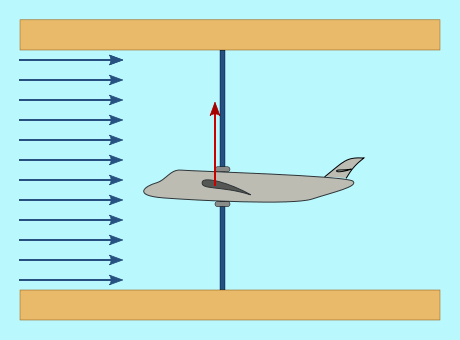
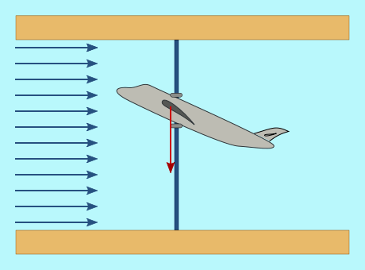

---
tags:
- stalling
- stall
- pitch
- active pitch
- active stall
- abs max
- fixed-pitch wind turbines
- controllability
- lifting
- lift
- dragging
- laminar flow
---

# By entry into losses (Stalling)

There is an effect known as "<u>*entry into losses*</u>" or "<u>*stalling*</u>" that produces a decrease in the lift force that makes the blades rotate (see [Why do the blades rotate?](PFAPorquegiranlaspalas.md)). This effect is the one presented when an airplane increases the attack angle of its wings to the wind, above a certain value, as shown in the following graphs.

| In this case the wing angle makes an upward force exist on them. The **red vector** indicates the difference between this upward force and the airplane weight.  <button onclick="document.getElementById('AvionSubiendo').src='lib/AvionSubiendo.gif';">Refresh</button> | When the angle is too large, the upward force is lower than the airplane weight, due to the wing entry into losses.  <button onclick="document.getElementById('AvionBajando').src='lib/AvionDescendiendo.gif';">Refresh</button> |
|---|---|
|  | When the angle is small the laminar flow around the wing or the blade is not broken. |
|  | When the angle exceeds a certain value, the laminar flow disappears from the final zones of the blade, and ***turbulences*** appear, so that the surface that contributes to the lift is reduced, and therefore the force that "pulls" the blade upward (**lifting**), with respect to the previous case. |
|  | It is also possible to induce the creation of turbulences by changing the attack angle direction. This technique is used in the control solution called "**Active Stall**". The advantage here consists in that a much smaller angle than in the previous case is necessary to enter into losses. |

Fig 1

In the following figure the curves corresponding to the evolution of the vertical thrust (lifting) and wind-direction (dragging) forces as a function of the Pitch are shown. See in [Why do the blades rotate?](PFAPorquegiranlaspalas.md) the relationship of these forces with those that determine the blade rotation forces and the thrust on the Tower.

It can be seen that when entering into losses the behavior changes, so that a wind increase corresponds to a decrease in the "lifting" force and therefore in the power obtained from the wind to rotate the Hub. It can also be seen in the red curve that when entering into losses the force acting on the Tower increases. That is, entry into losses implies additional loads on the Tower.

Fig 2.

The following figure shows the power curve obtained from the wind for fixed-pitch wind turbines, in which the effect of the entry into losses on the power is seen. In these cases, the blade is designed so that the wind level at which the entry into losses occurs is somewhat higher than the Nominal Wind. This passive response helps the wind turbine controllability: that is, it contributes to it not racing when the wind increases a lot.

Fig 3.

The following figure shows the result of using the entry into losses with the "Active Stall" control technique, in which the Pitch is used to "force" the entry into losses with wind lower than the blade's own. In this figure two zones can be seen:

a) in the wind zone below the nominal wind (around 12 m/s in the graph) the Pitch remains at 0º, which corresponds to a maximum Cp (see [Aerodynamic coefficient](Conceptossobrelapotencia.md));

b) above the nominal wind, when we need to reduce the power obtained from the wind, the blade is set at a small angle against the wind (negative Pitch sign). The absolute value of that angle decreases as the wind increases, which reflects the same entry into losses phenomenon seen in the fixed-angle blades.

Fig 4.

Applying this pitch control, the characteristic Power vs Wind curve in a wind turbine controlled by Active Stall is shown in the following figure.

Fig 5.

As can be checked by comparing figures 3 and 5, the production with winds above the Nominal Wind improves notably in the case of wind turbines with variable pitch angle and "Active Stall" method.
