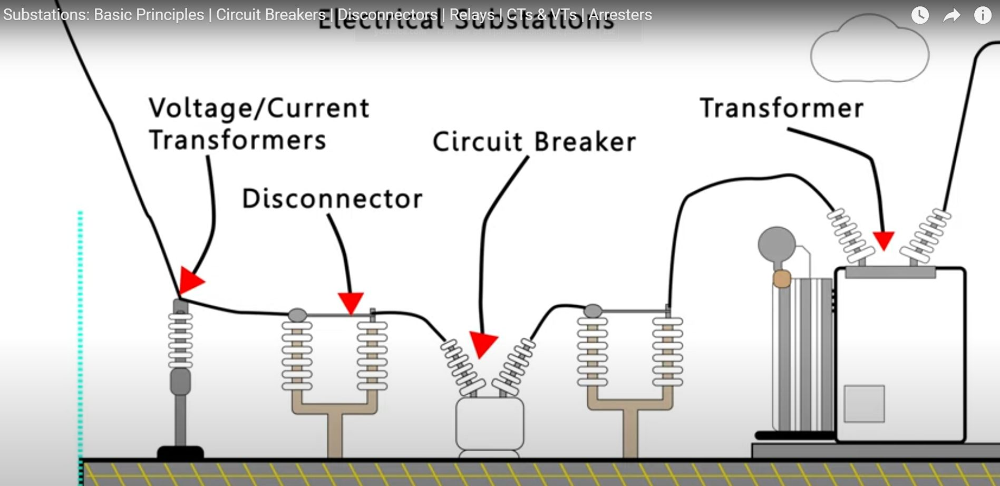

# Description of electrical Substation elements

An introduction to the main elements inside an electrical substation, including voltage transformers (VT) and current transformers (CT), disconnectors, circuit breakers, relays and transformers.

[https://youtu.be/pDpIoeWDjuM](https://youtu.be/pDpIoeWDjuM)

Copyright [Visual Electric](https://www.youtube.com/@VisualElectric_)

