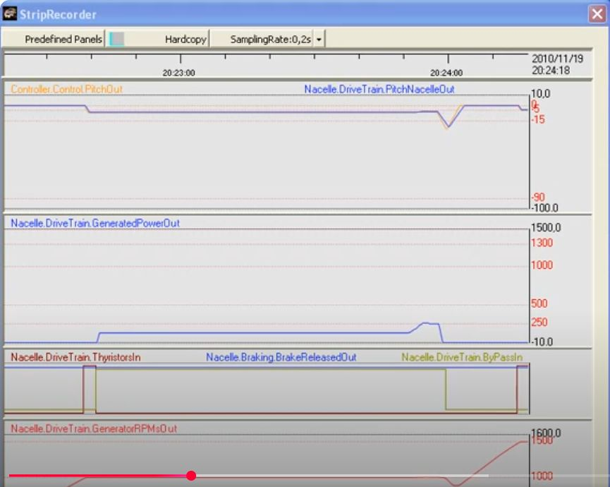

# Influence of the blade attack angle change control mechanism of a wind turbine

Example of the influence of the blade angle change mechanism state on the wind turbine behavior.

Copyright ACMSL    [https://youtu.be/VEHCFXppeNk](https://youtu.be/VEHCFXppeNk)

