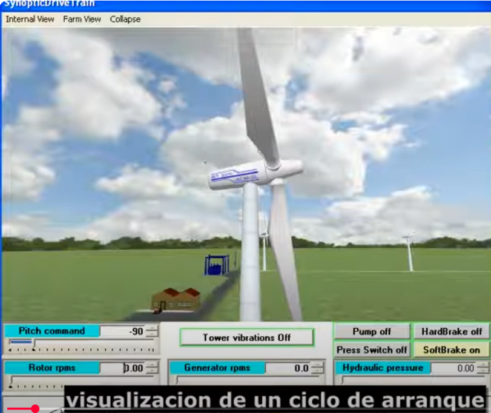

# Start-up and Stop operations of a Wind Turbine

The evolutions of a Wind Turbine with an asynchronous Squirrel Cage type electrical Generator (short-circuited rotor), and with Power Train control through Forced Entry into Aerodynamic Stall (Active Stall), are presented, during the Grid Connection and Production entry (cutin) and grid disconnection (cutout) and Stop operations

Copyright ACM SL.

[START/STOP operations Video of a Wind Turbine - Automated Computing Machinery SL](https://www.acm-sl.com/es/video-start-stop-espanol)

