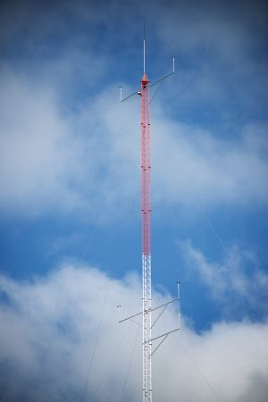

# About the Meteorological Station

The Wind Farm has a meteorological tower whose components are described **[here](../WFSSCADA/Meteorologicalinstruments.md)**. The data collected in it are sent to the SCADA. The wind data (direction and intensity) collected in the Meteorological Station are independent of those measured in each wind turbine, through anemometers and wind vanes on the wind turbine itself.

In the main synoptic of this Simulator, the controls are available to simulate the wind intensity and its direction, as well as to vary the **ambient temperature**, the **atmospheric pressure** and the **ambient humidity**. See in the [tutorial](../WFSSCADA/Meteorologicalstation.md).

Vary the values of these last three controls and **observe the air density variation**. The power generated by the wind turbine is directly proportional to the air density.

*Is there any combination of ambient temperature, atmospheric pressure and humidity that makes the air density maximum?*
